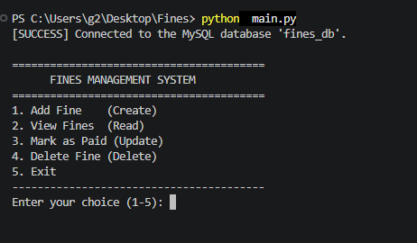
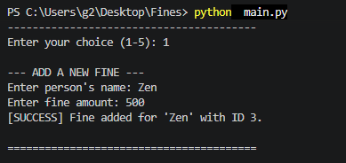
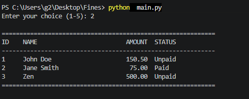
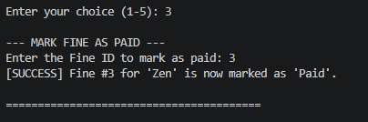
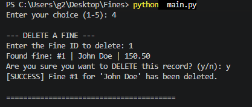
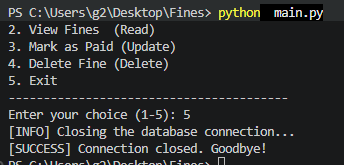

# Fines Management System

AI Assisted Coding - Kenneth Panio

A console-based (terminal) CRUD application for tracking people who owe money, built with **Python** and **MySQL**. No GUI — everything runs in the terminal with a menu-driven interface.

## Project Files

| File | Purpose |
|------|---------|
| `fines_db.sql` | SQL script that creates the database `fines_db` and the table `fines` |
| `db_helper.py` | Database connection functions and reusable input validation helpers |
| `main.py` | CRUD operations + main menu loop (run this file to start) |

## Requirements

- Python 3.x
- MySQL Server
- The Python MySQL driver:

```
pip install mysql-connector-python
```

## Setup

1. **Create the database and table** by running the SQL script once. From a terminal, inside this folder:

   ```
   mysql -u root -p < fines_db.sql
   ```

   (Or open the MySQL monitor, log in, and paste the contents of `fines_db.sql`.)

2. **Set your MySQL password** — open `db_helper.py` and change this line inside `connect_db()`:

   ```python
   password="",          # <--- CHANGE THIS to your MySQL password
   ```

3. **Run the application**:

   ```
   python main.py
   ```

## Usage

When the app starts, you will see this menu:

```
========================================
      FINES MANAGEMENT SYSTEM
========================================
1. Add Fine    (Create)
2. View Fines  (Read)
3. Mark as Paid (Update)
4. Delete Fine (Delete)
5. Exit
----------------------------------------
```

| Option | What it does |
|--------|--------------|
| 1 | Asks for a person's name and fine amount, then saves a new record with status `Unpaid` |
| 2 | Displays all records in a formatted table (ID, NAME, AMOUNT, STATUS) |
| 3 | Asks for a Fine ID, verifies it exists, and changes its status to `Paid` |
| 4 | Asks for a Fine ID, verifies it exists, asks for a `y/n` confirmation, then deletes the record |
| 5 | Closes the database connection properly and terminates the program |

## Screenshots

### Main Menu (and successful database connection)



### 1. Add Fine (Create)



### 2. View Fines (Read)



### 3. Mark as Paid (Update)



### 4. Delete Fine (Delete)



### 5. Exit



## Database Table Structure

Table name: `fines` (in database `fines_db`)

| Column | Type | Notes |
|--------|------|-------|
| `fine_id` | INT | Primary Key, Auto Increment |
| `person_name` | VARCHAR(100) | Not empty |
| `amount` | DECIMAL(10,2) | Positive number |
| `status` | VARCHAR(20) | Defaults to `'Unpaid'` |

## Key Design Points

- **Parameterized SQL ( `%s` )** is used for ALL database operations — no string concatenation — to prevent SQL injection.
- **Modular code**: connection/validation helpers are in `db_helper.py`; the CRUD operations and menu are in `main.py`.
- **Input validation**: empty names are rejected; the fine amount is parsed with `try...except ValueError` (must be a positive number); IDs must be whole numbers.
- **Record verification**: Update and Delete check the ID exists before acting; Delete additionally requires a `y/n` confirmation.
- **Exception handling**: every database operation runs in `try...except mysql.connector.Error` with a `finally:` block that safely closes the cursor, and `rollback()` on failed writes.
- **Debugging output**: results are tagged with `[SUCCESS]`, `[ERROR]`, or `[INFO]` so problems are easy to trace and demonstrate during debugging.
